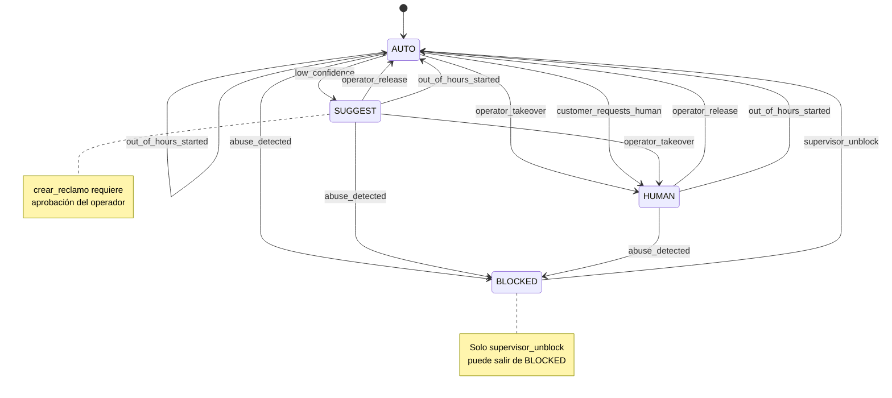

# SPEC_REVIEW.md — Revisión crítica de la especificación: Parte 3

## Diagrama de estados (Mermaid)

---

## Contradicciones detectadas

### C1 — HUMAN + abuse_detected: dos destinos en la tabla

**Problema en la especificación:**  
La tabla de transiciones original incluye dos filas para el mismo evento en el mismo estado:

| Estado actual | Evento         | Nuevo estado               |
|---------------|----------------|----------------------------|
| HUMAN         | abuse_detected | BLOCKED                    |
| HUMAN         | abuse_detected | HUMAN (el operador decide) |

Una máquina de estados determinista no puede tener dos destinos distintos para la misma clave `(estado, evento)`.

**Por qué es un problema:**  
Si dejamos `HUMAN + abuse_detected → HUMAN`, el operador retiene el control durante un evento de abuso, lo cual puede ser inseguro si el abuso también compromete al operador o al canal.  
Si elegimos `HUMAN + abuse_detected → BLOCKED`, el sistema asegura que ningún humano puede continuar respondiendo ante un abuso confirmado.

**Resolución adoptada:**  
`HUMAN + abuse_detected → BLOCKED`

**Justificación:**  
La seguridad tiene prioridad. El evento `abuse_detected` es el de mayor criticidad del sistema; aplicarlo de manera uniforme (siempre → BLOCKED) hace el comportamiento predecible y cierra el camino a que un operador comprometido continúe interactuando. La decisión sobre reabrir la conversación queda exclusivamente en manos del supervisor via `supervisor_unblock`.

**Test que verifica la resolución:** `test_c1_human_abuse_va_a_blocked_no_human`

---

### C2 — BLOCKED + operator_release: tabla vs. regla textual

**Problema en la especificación:**  
La tabla incluye la fila `BLOCKED + operator_release → AUTO`.  
Pero la regla textual dice explícitamente: *"Solo un supervisor puede sacar una conversación de BLOCKED."*

Ambas no pueden ser ciertas al mismo tiempo.

**Por qué es un problema:**  
Si el operador puede desbloquear con `operator_release`, entonces cualquier operador puede ignorar el bloqueo, vaciando de significado la figura del supervisor como rol de mayor jerarquía.

**Resolución adoptada:**  
Eliminar `BLOCKED + operator_release` de la tabla de transiciones.  
Desde `BLOCKED` solo existe la transición `supervisor_unblock → AUTO`.

**Justificación:**  
La regla textual es más específica que la tabla y refleja una intención de control jerárquico explícita. La tabla parece un error de copia (posiblemente replicada desde los patrones de HUMAN). Las reglas textuales describen el modelo de negocio; la tabla es solo un resumen tabular.

**Test que verifica la resolución:** `test_c2_blocked_solo_supervisor_desbloquea`

---

### C3 — out_of_hours_started desde "cualquier estado" rompe BLOCKED

**Problema en la especificación:**  
La tabla incluye la fila `Cualquiera + out_of_hours_started → AUTO`.  
Pero si "cualquiera" incluye `BLOCKED`, entonces un cambio de horario desbloquea automáticamente una conversación bloqueada por abuso, saltando la restricción del supervisor.

**Por qué es un problema:**  
`BLOCKED` es un estado de seguridad, no un estado operacional. Un evento de horario no debería poder superar un bloqueo por abuso. El supervisor eligió bloquear intencionalmente; un cron job de horario no debe revertir esa decisión.

**Resolución adoptada:**  
`out_of_hours_started` aplica a `AUTO`, `SUGGEST` y `HUMAN`, pero **no** a `BLOCKED`.  
Implementado omitiendo la fila `("BLOCKED", "out_of_hours_started")` de la tabla de transiciones.

**Justificación:**  
Jerarquía de prioridades: `BLOCKED` (seguridad) > `out_of_hours_started` (operacional). El nombre mismo del evento sugiere una causa de negocio, no de seguridad. Si la conversación bloqueada necesita atención fuera de horario, el supervisor debe actuar explícitamente con `supervisor_unblock`.

**Test que verifica la resolución:** `test_c3_out_of_hours_no_rompe_blocked`

---

## Casos ambiguos adicionales

### A1 — customer_requests_human: ¿solo desde AUTO?

La tabla solo define `AUTO + customer_requests_human → HUMAN`.  
No está definido qué pasa si el cliente solicita un humano estando ya en `SUGGEST` o en `HUMAN`.

**Interpretación adoptada:**  
- Desde `SUGGEST`: el operador ya está involucrado (aprueba borradores); un paso más directo a `HUMAN` sería razonable, pero no está en la tabla. Se respeta la tabla: la transición **no existe** desde SUGGEST.  
- Desde `HUMAN`: el cliente ya tiene atención humana; el evento no tiene sentido. Tampoco está definido.  
- En ambos casos, la transición lanza `TransicionInvalidaError` (comportamiento por defecto para transiciones no definidas).

### A2 — out_of_hours_started desde SUGGEST y HUMAN: ¿tiene sentido?

Si el sistema cambia a fuera de horario mientras un operador está en `SUGGEST` o `HUMAN`, pasar a `AUTO` significa que la IA retoma el control sin aviso explícito al operador.

**Interpretación adoptada:**  
Se implementa según la tabla (→ AUTO), porque la regla textual dice *"Fuera del horario de atención solo responde la IA"*. El cambio de horario tiene precedencia sobre el estado de control. Es responsabilidad del sistema notificar al operador que la sesión fue transferida a la IA.

### A3 — supervisor vs. operador: roles no modelados en código

La especificación distingue `supervisor` de `operador` como actores, pero no define un sistema de autenticación de roles.

**Interpretación adoptada:**  
El campo `actor` en el historial registra quién disparó el evento (string libre). En la consola interactiva, el operador usa `!unblock` que pasa `actor="supervisor"` para `supervisor_unblock`. En producción, esto debería estar protegido por autenticación real.

---

## Implementaciones adicionales post-revisión

### R1 — Fuera del horario: mensaje informativo al cliente

La consigna exige *"informa la franja de atención humana"*. Se implementó:
- Constante `HORARIO_ATENCION_HUMANA` en `estadospb.py` (DOC-11 no define horario específico; se usa configuración explícita).
- Flag `_fuera_de_horario` en `estadospb.py` que se activa con el evento `out_of_hours_started`.
- En `agentepb.main()`: cuando `out_of_hours_started` se dispara, se inyecta automáticamente un mensaje al cliente informando la franja y que la IA sigue disponible. El mensaje queda en el historial de mensajes para contexto futuro del LLM.

### R2 — Supervisor: verificación real de rol en Python

La consigna exige *"solo un supervisor puede sacar una conversación de BLOCKED"*.  
Se implementó en dos capas:

1. **`estadospb.transicionar()`**: `_ACTORES_REQUERIDOS` fuerza que `supervisor_unblock` solo pueda ser disparado con `actor="supervisor"`. Cualquier otro valor lanza `TransicionInvalidaError`. El estado no cambia.

2. **`agentepb._verificar_supervisor()`**: antes de llamar a `transicionar`, verifica el `SUPERVISOR_PIN` del entorno mediante `input()`. Si el PIN está vacío o es incorrecto, el comando `!unblock` es rechazado y nunca se llama a `transicionar`. No alcanza con declarar ser supervisor.

El comando `!unblock` está separado del diccionario `_COMANDOS_OPERADOR` para dejar explícita la distinción de privilegio en el código.

---

## Políticas de la Parte 2 en el contexto de la Parte 3

| Política Parte 2                         | Efecto en SUGGEST                                      | Efecto en HUMAN/BLOCKED       |
|------------------------------------------|--------------------------------------------------------|-------------------------------|
| 🔒 Confirmación explícita (crear_reclamo) | Se mantiene; además se exige aprobación del operador   | N/A — herramienta bloqueada    |
| 🔒 Idempotencia de reclamos               | Se mantiene igual — el hash es independiente del estado | N/A — herramienta bloqueada   |
| 🔒 Lista blanca de herramientas           | Se aplica primero; luego el filtro de estado            | Se aplica y bloquea todo       |
| Anti-prompt injection                    | Sigue vigente; los borradores solo salen con aprobación | N/A — el agente no responde   |

El orden de verificación en `ejecutar_herramienta()` es:
1. Lista blanca (nombre válido)
2. Estado de la máquina (¿herramienta permitida en este estado?)
3. Aprobación del operador (solo en SUGGEST + crear_reclamo)
4. Validación de argumentos
5. Ejecución real
